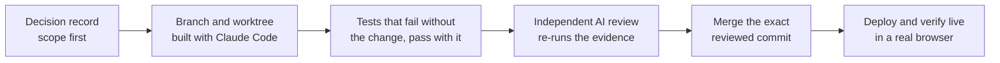

# How I Build with AI

I rebuilt my workflow around Claude Code in 2026. This page shows how I keep that speed honest, and the measurements
behind the claims in the [README](README.md).

## The loop every change goes through

1. **Decision record first.** A short, dated Architecture Decision Record sets scope before any code.
2. **One branch per change**, written with Claude Code as the primary development tool.
3. **Tests that prove the fix.** Each PR's tests are run with the fix removed (they must fail) and with it (they must
   pass), and nothing that passed before may break, checked by test name.
4. **Independent AI review on every PR**, including docs and config. The reviewer re-runs the evidence rather than
   trusting the pasted output, and adds hidden tests of its own for authorization, contracts and the audit chain.
5. **Merge only the exact commit that passed review.**
6. **Done means seen working live**: a visible browser against the deployed API, not a headless run or a mock.

## Rules learned the hard way

- **Never accept a "pre-existing failure" claim** without a clean-main run showing the same test failing by name. A
  matching count isn't proof.
- **Authorization, contracts and the audit chain get the hardest look.** That's where the real defects were, and each
  one shipped past a green test suite.
- **Unreachable is never healthy.** Dashboards and status claims must say "not measured" rather than guess.

## An example: when the AI was wrong

A review found that a calendar route let any authorized user read any mailbox the shared credential could reach. I
fixed it the same day with an operator-configured allowlist, enforced at the read route and again in both write
executors, plus regression tests. The same review found three more high-priority issues: tenant scoping on storage
prefixes, unsanitized rationale text, and a lost-update race on spreadsheet writes. All four were fixed and verified
within a day.

## Measurements

Counted from GitHub on 2026-11-17. "Built with Claude Code" means the merged PR carries the Claude Code footer.

| Repository (private) | Product | Merged PRs | With Claude Code | Test functions |
|---|---|---|---|---|
| `testpulse-proto` | TestPulse | 265 | 256 | about 11,300 |
| `testpulse-enterprise-contract` | Fiduciary, plus A&R's code | 842 | 793 | about 13,800 |
| `testpulse-aim` | AIM | 100 | 100 | about 4,000 |
| `testpulse-enterprise-ar` | A&R design records | 1 | 1 | none (documents only) |
| **Total** | | **1,208** | **1,150** | **about 29,000** |

All 1,208 merged pull requests were authored by me. Test functions are counted from source (Python `def test_` plus
TypeScript `it(`/`test(`); they measure tests written, not a pass rate.

## Private code review

The repositories above are private. For a guided walkthrough or time-limited read access, email
[triley@bmi2.com](mailto:triley@bmi2.com?subject=Private%20code%20review).

[Back to the portfolio](README.md)
