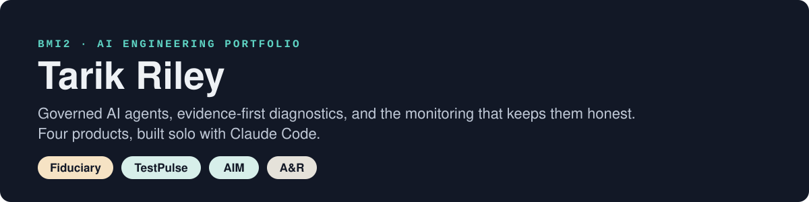
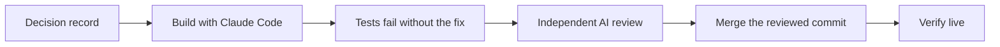

  

  
  
  
  
  

  <a href="https://www.bmi2.com/">bmi2.com</a> ·
  <a href="https://www.bmi2.com/demos/">Watch the demos</a> ·
  <a href="https://www.bmi2.com/engineering/">Engineering approach</a> ·
  <a href="https://www.bmi2.com/work-with-tarik/">Background</a> ·
  <a href="mailto:triley@bmi2.com?subject=Portfolio%20walkthrough">Book a walkthrough</a>

> [!NOTE]
> The four products' source repositories are private. This page shows what was built, with real screenshots from the
> lab and measurements counted from git. Images load live from bmi2.com, so they always match the site. A live
> walkthrough or time-limited code access is available on request.

  
   
  ▶ <a href="https://www.bmi2.com/">Watch the 2-minute video: <i>Two products. One rule.</i></a>

## The four products

<table>
  <tr>
    <td width="50%" valign="top">
      
      <h3>Fiduciary </h3>
      Governed AI for capital-investment lending. Agents cite permitted evidence and draft each step from intake to
      payoff; a person signs every step that moves money.
        <a href="products/fiduciary.md">Read more →</a>
    </td>
    <td width="50%" valign="top">
      
      <h3>TestPulse </h3>
      Evidence-first AI diagnostics for failed network logins. Names the cause, cites the packets behind it, and
      trains vendor-specific models from human-certified runs.
        <a href="products/testpulse.md">Read more →</a> · <a href="https://www.bmi2.com/demos/">4 demos ↗</a>
    </td>
  </tr>
  <tr>
    <td width="50%" valign="top">
      
      <h3>AIM </h3>
      Monitoring, business assurance and governance for the AI itself: model runs, spend against ceilings, a
      NIST-mapped risk register, and red-team scans behind a human approval.
        <a href="products/aim.md">Read more →</a>
    </td>
    <td width="50%" valign="top">
      
      <h3>A&amp;R </h3>
      Governed AI for artist development: roster answers with a 90% confidence gate, and drafted Slack, schedule and
      spreadsheet actions that a person approves.
        <a href="products/ar.md">Read more →</a>
    </td>
  </tr>
</table>

## See it working

**An honest refusal, with the reason.** Fiduciary's Ask AI, signed in as a junior analyst who isn't authorized for the
diagnosis lens: no search, no model call, and the reason on screen.

**A dashboard that won't pretend.** AIM when Fiduciary stops answering: the panel turns red with the cause and the last
success time, and it's never shown as healthy.

<table>
  <tr>
    <td width="50%" valign="top">
      <b>A&amp;R, the whole artist lifecycle.</b> A 10-artist roster, the AI lenses and the human approval layer on one page.
        
      
    </td>
    <td width="50%" valign="top">
      <b>Nothing trains without a human seal.</b> TestPulse's teaching cell: graded blind, signed by an expert, then
      QLoRA-trained on Amazon SageMaker.
        
      
    </td>
  </tr>
</table>

## Velocity, measured from git

| 1,150 | 41 days | 842 | ~29,000 |
|:---:|:---:|:---:|:---:|
| merged PRs built with Claude Code, Apr–Nov 2026 | AIM, from design decision to 100 merged PRs | Fiduciary PRs in 16 weeks | test functions, Python and TypeScript |

All counted from GitHub on 2026-11-17; every merged PR was authored by me. Per-repository figures and method:
[ENGINEERING.md](ENGINEERING.md).

## How I work

Speed only matters if the code is right. Every change, docs included, goes through the same loop:

A real catch: a review found a calendar route that let any authorized user read any mailbox the shared credential
could reach. I fixed it the same day, with the allowlist enforced at the route and again in both executors.
[More in ENGINEERING.md →](ENGINEERING.md)

## Stack

## Background

Twenty years in telecom automation and test engineering at AT&T, Verizon, Spirent, Viasat and DISH, before founding
BMI2 in Round Rock, Texas. [Full background →](https://www.bmi2.com/work-with-tarik/)

---

Copyright © 2025–2026 Tarik Riley / BMI2. All rights reserved. Portfolio review only; no license is granted to
copy, modify, redistribute, reverse engineer, or use the products, branding, designs, or documentation except as
permitted in writing by BMI2. See <a href="NOTICE.md">NOTICE.md</a>.
