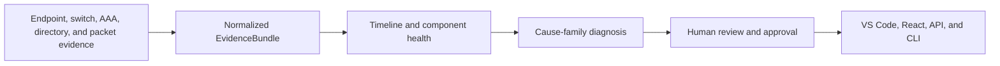

# TestPulse — Product Portfolio

**Evidence-grounded diagnostics for AAA, NAC, 802.1X, RADIUS, TACACS+, EAP-TLS, and packet-driven support workflows.**

[View the live TestPulse portfolio](https://www.bmi2.com/) ·
[Watch the product demonstrations](https://www.bmi2.com/#demo) ·
[Contact BMI2](mailto:triley@bmi2.com?subject=TestPulse%20portfolio%20review)

> This public repository contains sanitized product-portfolio material only. It does **not** contain TestPulse application source code, internal prompts, model configuration, customer data, credentials, proprietary test packs, or production deployment assets.

## What TestPulse Does

TestPulse turns fragmented authentication evidence into a single, reviewable run story:

- what failed;
- where it failed in the effective AAA path;
- which packet, log, state change, or policy fact proves it;
- whether the issue is transport, authentication, authorization, directory, policy, or post-auth network readiness;
- what an engineer should check next.

The platform is designed for QA, sustaining engineering, support, escalation, professional services, and network-security operations teams.

## Product Experience

| Surface | Portfolio view |
|---|---|
| VS Code experience | Guided MCP diagnosis, evidence review, baseline comparison, and human approval |
| React Run Viewer | Interactive timelines, topology, PCAP evidence, component health, and trends |
| REST API | Automation, CI/CD integration, repeatable run analysis, and artifact export |
| CLI | **Partial — diagnostic command coverage in progress.** Not yet at full contract-field parity with the REST and MCP surfaces (see note below) |
| AI appliance | Private inference and sealed adapters on dedicated on-premises hardware |
| Managed AI | Policy-routed managed reasoning |

> **Surface-parity note.** The React, VS Code (MCP), and REST surfaces return the same finding-contract fields for a given run. The **CLI does not yet** — its diagnostic command coverage is still being built out, so full contract-field parity is planned but **not yet implemented**. The CLI row is promoted once that work lands in the code repo.

## Evidence-First Architecture

Every public claim is intentionally high level. Detailed implementation contracts, source modules, test harnesses, internal agent instructions, and customer-specific topology remain private.

## Demonstration Areas

- 802.1X and RADIUS directory-path diagnosis
- TACACS+ transport degradation and evidence correlation
- Teaching Cell workflow with human sealing and adapter assurance
- Grounded diagnostic chat with approval before agentic action
- Private GN100, managed Bedrock, and policy-routed hybrid inference

See the [live demonstrations on BMI2.com](https://www.bmi2.com/#demo).

## For Hiring Managers and Technical Reviewers

This portfolio is intended to demonstrate:

- product architecture and systems thinking;
- network-security and AAA domain depth;
- evidence-driven AI design;
- full-stack product delivery across developer, API, CLI, and web surfaces;
- responsible handling of proprietary source and customer information.

For a guided walkthrough or a time-limited private technical review, email [triley@bmi2.com](mailto:triley@bmi2.com?subject=Private%20TestPulse%20technical%20review).

## Intellectual Property

Copyright © 2025–2026 Tarik Riley / BMI2. All rights reserved.

This repository is provided for portfolio review. No license is granted to copy, modify, redistribute, reverse engineer, or use the TestPulse product, branding, designs, or documentation except as permitted in writing by BMI2.
