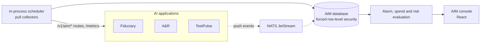

# AIM — Agentic Integrated Management

**Monitoring, business assurance and governance for AI applications.**

Status, Nov 2026: **running in the BMI2 lab**, watching Fiduciary and A&R; TestPulse is wired up next. Some newer
features (LangSmith traces, live red-team scans) are built but not yet deployed. A live walkthrough is available on
request; AIM isn't on the public demos page yet.

## The problem

Once AI agents are drafting actions and talking to real people, someone has to answer: Is it up? Is it within budget?
Is it behaving? What's the risk? Most dashboards answer optimistically. AIM is built to never show a comforting answer
it can't back up.

## What it does

AIM applies the telecom FCAPS model (Fault, Configuration, Accounting, Performance, Security) to AI:

| Area | What AIM tracks |
|---|---|
| Monitoring | Model runs, latency, circuit breakers, Kubernetes workloads, Langfuse traces, voice error rate and latency |
| Business assurance | Spend per application and per person against declared ceilings; alarms with acknowledgement and time to resolve |
| Governance | An AI risk register mapped to the NIST AI Risk Management Framework; audit-chain verification; readiness checks |
| Security | garak and PyRIT red-team scans, each gated behind a human approval and a spend cap |

## Architecture

- **Pull is the source of truth.** A pushed event never clears an alarm on its own; only a fresh pull does.
- **Strict separation.** AIM has its own service and database, and never reads another application's database. It
  talks to each one only through that application's own contract routes.
- **Versioned contracts.** AIM owns the observation contract; each application pins an exact version.

## The rules it follows

Each rule has its own test:

1. An application that can't be reached is never shown as healthy, and never shown blank.
2. Silence is not health.
3. Every number names its time window, its source application and its channel.
4. Kinds of absence are kept apart: "route not served", "unreachable" and "unauthorized" are different answers.
5. AIM's own failure is visible. With nothing to watch it says so, rather than "healthy".
6. Only a fresh pull clears an alarm.
7. Anything disabled is shown as off, never green and never as an alarm.

## Engineering facts

| | |
|---|---|
| Built | October 7 to November 17, 2026, solo, with Claude Code |
| Merged pull requests | 100 in 41 days |
| Test functions | about 4,000 |
| Stack | Python 3.12, FastAPI, Postgres with forced RLS, NATS JetStream, React and TypeScript, Kubernetes |

[Back to the portfolio](../README.md)
