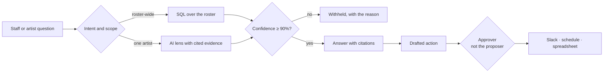

# A&R — Governed AI for Artist Development

**An AI coworker for an artist-development agency: roster answers with cited evidence, and drafted actions that a
person approves before anything happens.**

Status, Nov 2026: **design-partner stage**. The backend, staff interface and artist portal run in the BMI2 lab on
synthetic data. It shares Fiduciary's governed engine, kept separate by its own access groups, tenant and application.

## What it does today

- **Ask AI across the roster:** staff ask plain-English questions across a 10-artist synthetic roster. Answers come
  from SQL over real records or from the AI lenses, and anything under 90% confidence is withheld rather than guessed.
- **Role-based access:** nine access groups, from scout to finance to organization admin. Artists sign in to their
  own portal, and Postgres row-level security shows each one only their own records.
- **Human-approved actions:** the AI drafts task updates, schedule changes, spreadsheet edits and Slack posts. Each
  waits for a person with approval rights, and nobody can approve their own proposal.
- **Media as evidence:** the artist assistant cites pictures and video, fetched through an authorized route rather
  than a raw storage link.
- **Local voice:** dictation and spoken answers run on local speech models, so audio stays in the lab.

## Honest limits

- Calendar sync is built but not live; it needs credential changes on the Microsoft and Google side.
- Full operational data separation from Fiduciary is partly done.
- A signing-desk agent built on LangGraph, with a human pause, is in review and not yet merged.

[Back to the portfolio](../README.md)
