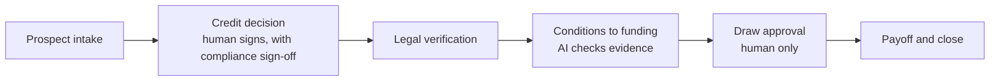
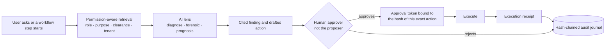

# Fiduciary — Governed AI for Capital-Investment Lending

**An AI coworker for underwriting and loan servicing that reads only what it's permitted to see, cites its evidence,
and waits for a person to approve anything consequential.**

Status, Nov 2026: **private preview**, running in the BMI2 Kubernetes lab on synthetic data only. The two-minute
"Two products. One rule." video on [bmi2.com](https://www.bmi2.com/) shows it working.

## The problem

Regulated lenders want AI help with underwriting and servicing, but can't give an AI broad credentials or let it act
on its own. Fiduciary lets AI agents do the evidence gathering and drafting, while access control, approvals and the
audit trail stay as strict as the firm's own.

## The loan lifecycle it covers

At each step the AI gathers the permitted evidence, cites it, and drafts the next action. The credit decision and
every draw are signed by a person, and the code rejects any other path.

## How a governed action works

## The guarantees

- **Least privilege:** the AI never holds broad credentials. Every read passes four checks at once: role, purpose,
  clearance level and tenant. Postgres row-level security enforces tenancy in the database itself.
- **Cited answers:** each finding links to its source records. Information the user isn't permitted to see never
  enters the model's context, caches, traces or training data.
- **Approval bound to the action:** an approval token is tied to a hash of the exact action it approves, so it can't
  be reused for another. Nobody can approve their own proposal.
- **A replayable record:** a hash-chained audit journal and an execution receipt for every action.
- **Supply chain:** signed releases with an SBOM, verified at load time.

## Engineering facts

| | |
|---|---|
| Built | July to November 2026, solo, with Claude Code |
| Merged pull requests | 842 in 16 weeks |
| Test functions | about 13,800 |
| Architecture Decision Records | 78, each dated with follow-ups |
| Postgres migrations | 95, with row-level security on tenant data |
| Stack | Python 3.12, FastAPI, Postgres (RLS, pgvector), Keycloak, MinIO, OPA, AWS Bedrock (Claude Haiku 4.5 by default), React and TypeScript, Kubernetes, Prometheus and Grafana |

## Honest limits

- A lab system on synthetic data, not a production deployment with customers.
- Local inference for air-gapped installs is planned, not built; inference runs on AWS Bedrock today.
- Review is enforced by convention (an independent AI reviewer on every PR), not by GitHub branch protection.

[Back to the portfolio](../README.md)
