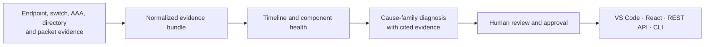
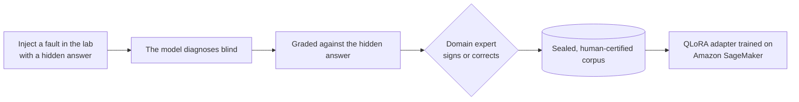

# TestPulse — Evidence-First AI Diagnostics for Network Logins

**When a device fails to log in to a network, TestPulse explains why and shows the evidence that proves it.**

Status, Nov 2026: **available now** (TestPulse Pro); deployed on Kubernetes in the BMI2 lab with Argo CD. Four
recorded demos are at [bmi2.com/demos](https://www.bmi2.com/demos/).

## What it does

TestPulse turns fragmented authentication evidence (802.1X, RADIUS, TACACS+, EAP-TLS, NAC) into one reviewable run
story:

- what failed;
- where it failed on the login path: endpoint, DHCP and DNS, switch, RADIUS or TACACS+, policy, directory, enforcement;
- which packet, log line or state change proves it;
- whether the cause is transport, authentication, authorization, directory, policy or post-login network readiness;
- what an engineer should check next.

It names each cause from a fixed vocabulary, such as `directory_path_degradation`, and never settles for "RADIUS is
flaky".

## Every interface

| Surface | What it offers |
|---|---|
| VS Code (MCP server) | Guided diagnosis, evidence review, baseline comparison and human approval; 155 MCP tool functions |
| React run viewer | Interactive timelines, topology, packet evidence, component health and trends |
| REST API | Automation, CI/CD integration, repeatable run analysis and artifact export |
| CLI | Diagnostic commands; full field parity with the REST and MCP surfaces is still in progress |
| AI | Retrieval and reasoning on AWS Bedrock; vendor-specific QLoRA adapters trained on Amazon SageMaker |

## The teaching cell: TestPulse as an AI trainer

- Nothing trains until a human expert has signed it, so the model can't grade its own homework.
- The curriculum climbs seven difficulty bands, from single faults to compound faults masked by noise.
- The adapter is about 7 MB, small enough to sign, version and diff. Running it on the network device itself is the
  long-term goal.

## Engineering facts

| | |
|---|---|
| Built | March to November 2026, solo, with Claude Code |
| Merged pull requests | 265 |
| Test functions | about 11,300 |
| Stack | Python 3.12, FastAPI, React 18 and TypeScript, MCP, SQLite or Postgres, AWS Bedrock and SageMaker, Kubernetes with KubeVirt and Argo CD, Playwright, a FreeRADIUS, tac_plus and OpenLDAP lab |

[Back to the portfolio](../README.md)
